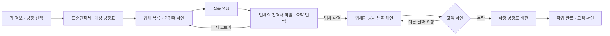
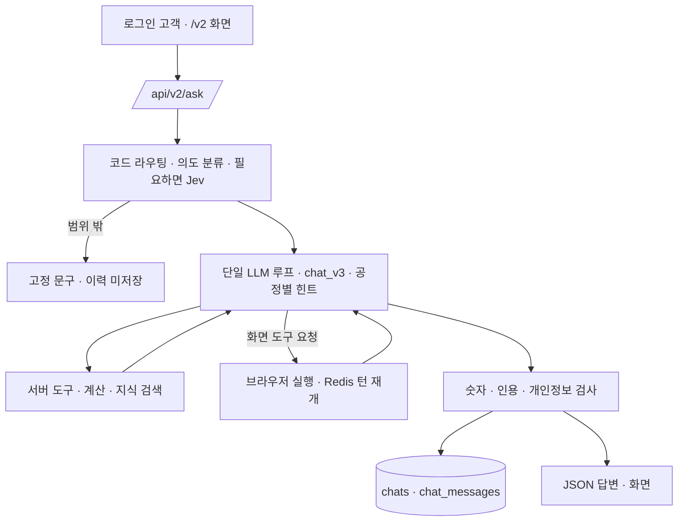
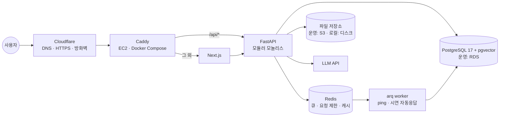

# 🏠 믿집 (MitJip)

> **반셀프 인테리어를 위한 표준견적, 공정 관리 서비스**
> 공공 기준의 **표준견적서**와 업체가 입력한 **가견적·실측 견적서**를 비교하고, 업체별 공사 일정까지 관리하도록 돕는 반셀프 인테리어 서비스

SK Networks Family AI Camp 34기 · FINAL 1팀

**현재 코드 기준(2026-11-18, `dev` 커밋 `1a3e656`):** 기존 고객·업체 흐름에는 도배·목공 표준견적, 업체 승인·선택, 실측 요청, 견적서 파일, 업체 확정과 날짜 수락 API·화면이 있습니다. 별도 `/v2` 상담 화면은 **도배만 노출**하며, 견적·공정표 계산과 JSON 방식 AI 대화·선택값 저장을 연결합니다. **하나의 공종 하위 에이전트를 도배·목공 설정으로 운영하는 구조**, SSE, 일정 MCP와 실서비스 worker 작업은 후속입니다. 현재 기능별 판정·테스트·이슈·PR 근거는 [기능 개발표](docs/feature-roadmap.md)를 확인하세요. 이 설명은 AWS 배포 및 전체 수동 QA 완료를 뜻하지 않습니다.

**문서 입구:** [전체 문서 목차](docs/README.md) · [API 안내·97개 엔드포인트](docs/api/README.md) · [개발 환경과 실행](docs/development.md) · [개발·배포 흐름](docs/development-flow.md) · [테스트와 QA](docs/testing.md) · [기준 데이터 적재](docs/reference-data.md)

---

## 📌 목차

1. [팀 소개](#-팀-소개)
2. [프로젝트 개요](#-프로젝트-개요)
3. [경쟁 서비스와 차별점](#-경쟁-서비스와-차별점)
4. [주요 기능](#-주요-기능)
5. [서비스 흐름](#-서비스-흐름)
6. [AI 에이전트 구조](#-ai-에이전트-구조)
7. [표준견적서 데이터](#-표준견적서-데이터)
8. [시스템 아키텍처](#-시스템-아키텍처)
9. [기술 스택](#-기술-스택)
10. [프로젝트 구조](#-프로젝트-구조)
11. [실행 방법](#-실행-방법)
12. [개발 규칙](#-개발-규칙)
13. [평가](#-평가)
14. [개발 일정](#-개발-일정)
15. [향후 계획](#-향후-계획)
16. [회고](#-회고)

---

## 👥 팀 소개

| 이름 | 담당 | GitHub |
| :---: | --- | :---: |
| 이성민 | 인프라 · MVP 흐름 UI/UX | [@lsm15111](https://github.com/lsm15111) |
| 이현준 | 백엔드 · 데이터 수집 | [@gksrkd2](https://github.com/gksrkd2) |
| 임형준 | 산출물 · LLM · 에이전트 | [@HyeongJjun](https://github.com/HyeongJjun) |
| 전진환 | ML · DL · 데이터 수집 | [@dfs32dfs](https://github.com/dfs32dfs) |
| 채정석 | 기획 · 데이터 수집 · 프론트엔드 | [@qnfdhk-rgb](https://github.com/qnfdhk-rgb) |

---

## 💡 프로젝트 개요

### 시장 배경: 고쳐 쓸 집이 늘고, 시장도 커짐

| 지표 | 내용 |
| --- | --- |
| 준공 20년 이상 주택 | 전국 주택 중 비율이 2021년 처음 **50%** 를 넘음 |
| 리모델링 시장 | 2020년 30조 원 → 2030년 **44조 원** 전망 |
| 집 사는 데 드는 목돈 | 수도권 집값은 한 해 소득의 **8.7배**, 생애 첫 집 마련까지 **7.9년** |
| 산 집은 점점 구축 | 서울 아파트 매매 중 준공 30년 넘은 집 **20.3% → 23.8%** |

> 목돈을 쓴 뒤라 인테리어는 아끼고 싶고, 낡은 집을 사서 고칠 곳은 많음 → **반셀프 인테리어 수요**

<sub>출처: 한국건설산업연구원 보도자료(2020), 건산연 2020.12, 통계청(SBS Biz), 국가데이터처 2025 인구주택총조사(뉴시스 2026.07), 국토교통부 2024년도 주거실태조사(뉴시스 2025.11.16), 국토교통부 실거래가 분석(MTN 2026.04.21)</sub>

### 인테리어 방식 3가지

믿집은 가운데 **반셀프**를 돕는 서비스입니다.

| | 턴키 | **반셀프 (믿집 대상)** | 셀프 |
| --- | --- | --- | --- |
| 방식 | 업체 1곳이 설계부터 마감까지 | 공정별 업체를 내가 골라 연결 | 시공까지 내가 직접 |
| 업체가 맡는 범위 | 업체가 전부 | 공정별 업체, 조율은 나 | 내가 전부 |
| 비용 | 높음 | 중간 | 낮음 |
| 어려움 | 편하지만 총액 견적이라 내역이 잘 안 보임 | 견적 비교 · 업체 검증 · 일정 조율이 전부 내 몫 | 기술 · 시간이 들고 하자도 내 책임 |

### 문제 정의: 반셀프 6단계, 단계마다 막힘

| 단계 | 막히는 점 | 근거 | 믿집 화면 |
| --- | --- | --- | --- |
| 1. 정보 수집 | 무엇부터, 어떤 서류부터 할지 모름 | 반셀프 컨설팅이 **시간당 10만 원**에 거래됨 (숨고), 동의서 · 행위허가도 소비자가 직접 (서울신문 2026.07) | 안내 |
| 2. 공정표 짜기 | 공정 순서를 모름, 목공 전에 도배하면 재시공 | 목공(몰딩, 걸레받이)이 끝나야 도배로 넘어갈 수 있음 | 예상 공정표 |
| 3. 가견적 | 업체마다 견적이 제각각, 적정 금액 기준이 없음 | 같은 집인데 업체 견적 2,500만 vs 4,000만 원, **1.6배** 차이 (비즈한국) | 표준견적서 |
| 4. 실측, 실견적 | 업체마다 양식이 달라 비교가 어렵고, 실측 뒤 금액이 바뀌어도 따질 근거가 없음 | | 견적 비교 · 설명 |
| 5. 업체 선정 | 검증 수단은 후기뿐 | 인테리어 업체 **70~80%** 가 실내건축공사업 면허 없음 (서울신문 2026.04.01) | 업체 고르기 |
| 6. 공사 진행 | 여러 업체 일정을 직접 조율, 한 공정이 밀리면 뒤도 밀림 | "다시 하라면 힘들어서 못 하겠다" (반셀프 경험자, 비즈한국) | 확정 공정표 |

### 서비스 대상

- **고객**: 아파트 반셀프 인테리어를 준비하는 소비자
- **업체**: 사업자등록증으로 가입하고 관리자 승인을 받은 공정별 시공 업체

### 1차 범위 (MVP): 아파트 도배 · 목공

```
철거 → 설비·전기 → [목공] → 타일 → 도장 → [도배] → 바닥 → 가구·조명
                    1차 범위               1차 범위
```

| 왜 두 공정부터인가 | |
| --- | --- |
| 가장 기본이 되는 공정 | 집 고치기에 거의 빠지지 않아 먼저 검증하기 좋음 |
| 공공 데이터로 검증 가능 | 일위대가에 도배 · 몰딩 단가가 있음 |
| 순서가 틀리면 재시공 | 목공 전에 도배하면 다시 해야 함 → 공정표의 가치가 분명함 |

범위 밖(바닥 · 욕실 · 전기, 전자계약, 결제)은 [향후 계획](#-향후-계획)으로 관리합니다.

---

## 🆚 경쟁 서비스와 차별점

보증 · 현장 관리 · 정해진 가격은 있지만, 반셀프 소비자가 직접 하는 일은 남아 있습니다.

| | 오늘의집 | 집닥 | 아파트멘터리 | 숨고 | 반셀인 | **믿집** |
| --- | :---: | :---: | :---: | :---: | :---: | :---: |
| **기준 가격** | △ 상담 뒤 업체 견적 | × | △ 자기 회사 가격표 | × | × | **○ 공공 기준으로 계산** |
| **견적 비교** | × | × | × | △ 여러 업체 견적 | △ 업체와 직접 연결 | **○ 같은 양식으로 비교** |
| **일정 관리** | △ 늦어지면 보상 | △ 담당자가 현장 점검 | △ 자기 회사가 시공 | × | × | **○ 공정표로 일정 관리** |

<sub>○ 있음 · △ 일부 · × 없음 / 출처: 바이라인네트워크 2023.06.23(오늘의집), 오늘의집 파트너 표준견적서 작성 가이드, 인사이트(집닥), 벤처스퀘어(아파트멘터리), App Store(숨고, 반셀인)</sub>

### 차별점 1. 표준견적서: 상담 전에 보는 공정한 비교 기준

믿집은 상담 전에도 계산 엔진으로 **공공 기준 참고 금액**을 계산합니다. 금액은 입력 조건과 계산 엔진에 등록된 단가·가정에 따르며, 실제 시공 업체가 청구하는 확정 금액은 아닙니다. 자료의 적재·활성 여부와 계산용 고정 단가의 차이는 [기준 데이터 안내](docs/reference-data.md)에 정리했습니다.

| 항목 | 출처 |
| --- | --- |
| 인건비 | 2026 상반기 표준일위대가 (실내건축) |
| 자재비 | 조달청 가격 + 시중 가격 (수집 예정) |
| 간접비 | 법령 · 고시 요율 |
| 물량 | 우리 집 정보 (평형, 바탕면, 길이) |

### 차별점 2. 공정별 AI 상담: 같은 조건 · 같은 칸으로 비교

견적에 필요한 조건을 상담과 화면에서 정리하고 계산 결과로 보여 줍니다. 실측 견적서는 업체가 **자신의 양식 파일**을 제출하며, 금액·부가세 방식 등 요약 칸을 별도로 입력합니다. 실측 파일 전체를 공통 행 양식으로 변환하는 OCR 기능은 아직 없습니다.

1. **모르는 조건은 대신 물어봄** — 기존 벽지를 뜯을지 · 덧바를지처럼 견적에 필요한 것
2. **모르면 '실측 후'로 남김** — 억지로 정하지 않고 실측 때 업체가 확인
3. **정리한 조건은 표준견적서로** — 수량 계산에 그대로 쓰임

### 차별점 3. 공정표: 반셀프도 일정 관리를 받음

믿집은 목공 → 도배의 순서를 계산한 **예상 공정표**를 만들고, 확정된 업체의 공사 날짜 제안과 고객 수락·변경 요청을 기록합니다. 일정 MCP로 여러 업체의 연기를 자동 조율하는 기능은 후속입니다. 계산 엔진은 반나절 작업량을 하루 단위 일정으로 보여 줍니다.

| 근거 | 데이터 |
| --- | --- |
| 작업 기간 | 물량 × 품 (표준일위대가) |
| 공정 순서 | 표준시방서 선후 규칙 |
| 공휴일 | 공공데이터 특일 정보 |
| 공사 가능 시간 | 공동주택 관리규약 |

---

## ✨ 주요 기능

| 구분 | 기능 | 설명 |
| --- | --- | --- |
| 고객 | 프로젝트 시작 | 집 정보 입력, 공정 선택 |
| 고객 | 표준견적서 · 예상 공정표 | 공공 기준 단가로 계산한 참고 금액과 예상 일정 |
| 고객 | v2 AI 상담(구현, 검증 별도) | `chat_v3` 단일 대화 루프, 도배·목공 공정 힌트, 근거 검색, 화면 도구, 한 번에 JSON 응답 |
| 고객 | 업체 고르기 | 해당 공종 업체 목록·가견적과 업체 상세 확인, 실측 요청(공정당 최대 3곳) |
| 고객 | 견적 비교 | 표준견적·가견적·업체가 제출한 실측 견적 파일과 금액 요약 비교 |
| 고객 | 공정표 관리 | 예상·확정 공정표 계산, 날짜 제안·수락·변경 요청, 작업 완료 확인 |
| 업체 | 가견적 · 실측 견적 제출 | 자체 확인 단가 묶음 관리, 자체 견적서 파일 제출·버전 보관 및 요약 금액 입력 |
| 업체 | 일정 관리 | 공사 날짜·인원 제안 및 재제출 |
| 관리자 | 업체 심사 | 사업자등록증 첨부 신청에 대한 승인·보완·거절. 회원 목록 화면의 실제 DB 연결은 부분 구현 |

상태와 검증의 구분은 [기능 개발표](docs/feature-roadmap.md)를 기준으로 합니다. `/v2` 화면은 현재 도배만 보여 주며, 기존 고객·업체 흐름의 목공 지원과 구분됩니다.

---

## 🔄 서비스 흐름



---

## 🤖 AI 에이전트 구조

현재 `/v2` 상담은 **오케스트레이터 한 개의 LLM 대화 루프**입니다. 코드가 의도를 분류하고 도배·목공 단어와 지시문을 더하며, 숫자 계산과 근거 검색은 서버 도구로 처리합니다. 독립 공종 하위 호출은 아직 연결되지 않았습니다.



| 구성 | 역할 |
| --- | --- |
| **입구 관문** | 코드 라우터 + 의도 분류 모델. 범위 밖 요청은 LLM 없이 안내 |
| **단일 상담 루프** | `v2/ask.py`가 `chat_v3`와 역할 힌트·도구 호출을 관리. `v2/ask_chat.py`는 완료한 일반 대화만 저장 |
| **공정별 설정** | 도배·목공 설정과 지시문은 존재하고 코드가 질문에 맞춰 붙임. `trade_agent.py`는 실패를 반환하는 뼈대 |
| **서버 도구** | 기준금액·일정 조건 계산, 활성 RAG 검색(BM25 + pgvector 결과 결합) |
| **화면 도구** | 고객 값 제안·단계 카드 요청을 브라우저가 실행하고 서버 턴을 재개. 실제 값 저장에는 화면 확인이 필요 |
| **출력 검사** | 숫자·출처·민감 정보 등을 검사. 모델 응답의 실제 품질은 유료 평가·화면 QA로 별도 확인 |

### 단일 공종 하위 에이전트 계획 (미구현)

팀의 목표는 **공종 에이전트 한 개**가 공정별 설정(`trades/dobae.py`, `trades/mokgong.py`)과 지식 검색 결과를 받아 공정별 조건·주의점·근거 번호를 정해진 형태로 오케스트레이터에 돌려주는 것입니다. 고객에게는 오케스트레이터 하나만 답합니다. 현재 `trade_agent.py`는 실패 반환 뼈대이며 실제 하위 호출이 없습니다.

| 설정 | 확인할 조건 예시 | 결과에 포함할 내용 |
| --- | --- | --- |
| 목공 | 몰딩·걸레받이 길이, 문틀 교체 여부 | 빠진 조건, 시공 주의점, 근거 번호 |
| 도배 | 바탕면 상태, 기존 벽지 철거 여부, 도배 유형 | 빠진 조건, 시공 주의점, 근거 번호 |

### 목표 호출 흐름 예시 (현재 실행되는 호출 아님)

```
고객 질문 → 입구 관문 → 오케스트레이터
  → 공종 에이전트 한 개
     → 코드가 공정 선택: 목공 · 도배
     → 공정별 설정 + 지식 검색 결과로 조건 · 주의점 · 근거 번호 구성
     → 구조화한 결과를 오케스트레이터에 반환
  → 오케스트레이터가 출처를 붙여 한 답으로 전달
```

- 현재 상담 한 턴에는 도구 호출 **라운드** 최대 4회(`MAX_TOOL_ROUNDS`)와 LLM 호출 최대 6회(`MAX_CALLS`)를 적용합니다. 사용자별 상담 요청은 시간당 최대 60회(`ASK_PER_HOUR`, 로컬 환경 예외)입니다. 공종 하위 호출 3회와 일일 토큰 한도는 팀이 정한 후속 제한입니다.
- 의도 분류 신뢰도가 낮으면 Jev 보조 분류를 사용합니다. Jev 실패 뒤 선택지로 되묻는 개선은 후속입니다.
- 검색은 활성화한 DB 자료를 대상으로 BM25와 pgvector 결과를 결합합니다. 데이터 적재·활성 여부는 환경마다 다릅니다.
- 일정 MCP 서버 파일(`mcp_server.py`)은 현재 비어 있으며 서버·클라이언트 연결이 없습니다. 답변은 SSE가 아닌 JSON으로 한 번에 전달됩니다.

실제 호출·DB 저장·계약과 목표 하위 호출의 차이는 [AI 상담 협약](docs/agent-contract.md) 및 [v2 구조](docs/v2/structure.md)에 기록했습니다.

---

## 🗂 표준견적서 데이터

### 데이터가 어려웠던 이유

공공데이터는 허가 · 신고에서 쌓이는데, 인테리어는 대부분 신고하지 않습니다.

- **건축**: 공사 → 허가 · 신고 → 건축물대장 → 공공데이터로 통계가 쌓임
- **인테리어**: 도배 · 목공 · 욕실 공사 → 구조를 바꿀 때만 신고 → 가격 · 날짜 기록이 남지 않음

| 그 밖의 이유 | 내용 |
| --- | --- |
| 작은 공사 | 1,500만 원 미만은 건설업 등록 없이 시공 가능 → 통계 밖 공사가 많음 (건설산업기본법 시행령 제8조) |
| 가격 자료 | 관공서 공사 단가는 있지만 인테리어 거래가는 공개된 가격표가 없음 |
| 제각각인 견적 | 자재 · 디자인 · 현장 상태 · 견적 방식이 달라 같은 기준이 없음 |
| 바꾸는 주기 | 10~15년마다 바꾸는 소모성 공사라 나라가 기록하지 않음 |
| 담당 기관 | 국토부 · 산업부 · 공정위 · 소비자원으로 나뉘어 모아 정리할 곳이 없음 |

### 해결 방법: 공공 기준으로 직접 만들고, 부족한 부분은 서비스 데이터로

| 단계 | 견적서 | 공정표 |
| --- | --- | --- |
| **1차** 공공 기준으로 시작 | 표준품셈 + 건축 일위대가 (도배 벽 1㎡ 노무비 6,656원) | 건축공사 표준시방서 |
| **2차** 실내건축 자료로 보충 | 실내건축 일위대가 | LH 전문시방서 |
| **3차 · 예정** 서비스 데이터로 고침 | 업체 단가 · 실측 견적 금액 | 실제 공사 날짜 · 연기 기록 |

- **자재비**: 1차(예정)는 조달청 가격으로 공공 기준 → 3차는 업체 견적에 적힌 자재 단가로 시중 가격 보정
- 서비스 데이터는 개인정보를 빼고 모아 정제합니다.

| 수집 예시 | 내용 |
| --- | --- |
| 표준품셈 | 하루 95㎡ = 도배공 2 + 보통인부 1 |
| 실내건축 일위대가 | 도배바름 1㎡ → 6,672원 |
| 물량 · 평면도 | 벽 도배 면적 59㎡ 126.97㎡ · 84㎡ 180.09㎡ (AI Hub 도면 기반 물량 산출서, 팀 작성) |
| 표준시방서 | 도배 공정 순서 → 공정표 단계 |
| LH 시방서 | 72시간 전 ~ 48시간 후 5℃ 이상 → 건조 기간 |

<sub>자료: 2026 건설공사 표준품셈(× 2026.9.1 노임), 2026 실내건축 일위대가, 건축공사 표준시방서(KCS 41 51 05 등), LH 전문시방서(LHCS 41 51 05 등)</sub>

### 전처리 흐름

가이드북 CSV는 공유할 수 있지만 시공일지는 원본과 CSV 모두 저장소에 올리지 않습니다. 원본 PDF·엑셀은 저장소 밖에, 이미지·쪽별 JSON 등 작업 중간 파일은 Git에서 제외한 로컬 작업 폴더에 보관합니다. 아래 표는 시공일지를 제외한 공유 자료 목록이며, 보관 규칙은 [기준 데이터 사용 안내](docs/reference-data.md#상담-지식-자료-v2)를 따릅니다.

```
01 원본 수집 → 02 원본 확인 → 03 데이터 추출 → 04 데이터 분류
(공유 기준 자료 + 안내서)  (해시·페이지·시트·출처)  (PDF 본문·표, Excel 셀·수식)  (RAG용 9개, 정형 4개)
→ 05 표준화 → 06 CSV 생성 → 07 검증 → 08 메타데이터
(수치·단위 통일, 원본 값 보존)  (CSV 13개)  (누락·중복·수치 변형)  (출처·버전·적용 조건)
```

| 최종 산출물 | |
| --- | --- |
| 결과 | CSV 13개 · 레코드 **55,652개** (RAG 9개·716행 + 정형 4개·54,936행) |
| 원본 추적 | 해시 · 페이지 · 셀 위치 |
| 활용 | PostgreSQL · pgvector에 적재. 활성 RAG 자료는 검색에 사용하며 정형 자료 4종은 현재 비활성으로 유지 |

상담 자료 `data/consult/consult_knowledge_rag.csv`는 위 집계와 별도로 관리합니다.

- 원본을 바꾸지 않고 구조화
- 정확한 조회 · 계산은 정형 데이터, 시공 기준 · 규정 검색은 RAG
- 불명확한 값은 임의 보정 없이 검토 대상으로 표시
- 과거 법령 · 불명확 규정은 자동 계산에서 제외

---

## 🏗 시스템 아키텍처

스테이징 배포 구성은 **EC2의 Docker Compose**, **RDS**, **S3**를 사용하도록 작성돼 있습니다. 이 문서 작업에서 실제 AWS 가동·배포 SHA는 확인하지 않았습니다. 로컬은 `compose.yaml`과 `compose.override.yaml`로 DB까지 실행합니다.



| 구성 | 역할 |
| --- | --- |
| `frontend/` (Next.js) | 화면만 담당. DB 접근 · LLM 호출 · 금액 계산 없음 |
| `backend/app/` (FastAPI) | 유일한 공개 API. 기능 패키지 + 계산 엔진 `calc` + 에이전트 `agent` |
| `worker.py` (arq) | 현재 연결 확인 `ping`, `DEMO_AUTO` 시연 업체 자동응답만 등록. 일반 LLM 설명·단가 수집·발송 작업은 미구현 |
| PostgreSQL + pgvector | 원본 데이터와 지식 검색. 운영은 RDS |
| Redis | 큐 · 요청 제한 · 짧은 캐시 (지워져도 되는 데이터만) |
| S3 | 운영 파일 저장소 (사업자등록증 · 사진 등) |

---

## 🛠 기술 스택

| 분야 | 기술 |
| --- | --- |
| **Frontend** |    |
| **Backend** |     |
| **AI** | OpenAI SDK(대화·임베딩), 의도 분류 모델, Jev 보조 분류,  검색. 일정 MCP 패키지는 의존성만 있고 서버는 미구현 |
| **Database** |   |
| **Infra** |       |
| **CI/CD** |  |

---

## 📂 프로젝트 구조

```
SKN34-FINAL-1TEAM/
├── frontend/                # Next.js 웹
│   ├── app/                 # 화면 라우트: start · projects/[id] · my · vendor · admin · v2
│   ├── components/          # 화면 조각 + v2 상담·자재·견적·공정표
│   └── lib/                 # 세션 · API 호출 · 표시 형식
├── backend/                 # FastAPI API
│   ├── app/
│   │   ├── agent/           # 의도 관문 · LLM 호출 · 공정별 설정 (하위 에이전트 뼈대)
│   │   ├── calc/            # 도배·목공 표준견적 · 가견적 · v2 미리보기 · 공정표 계산
│   │   ├── knowledge/       # RAG 지식 적재 · 검색
│   │   ├── chat/            # 대화 저장과 rev 충돌 보호 (독립 SSE 라우터 미등록)
│   │   ├── v2/              # /v2/* 계산·대화 API · case 저장 · 출력 검사
│   │   ├── project/ vendor/ auth/ account/ files/ quote/ visit/ schedule/ shared/
│   │   ├── mcp_server.py    # 0바이트, 일정 MCP 미구현
│   │   └── worker.py        # ping · 시연(DEMO_AUTO) 등록
│   ├── migrations/          # Alembic
│   └── tests/
├── evaluation/              # intent · rag · answer · trade · ask_back 평가 자료와 실행기
├── data/                    # 공유 가능한 processed CSV와 기준 자료 문서, 로컬 전용 자료는 Git 제외
├── docs/                    # 기능 개발표 · 구조 · ERD · 상담 · 기준 데이터 · 개발/QA 안내
├── deploy/aws/              # 스테이징 배포 (compose · Caddyfile)
├── infra/aws/               # 인프라 정의
├── compose.yaml
├── AGENTS.md                # 사람과 AI 코딩 도구가 함께 지키는 작업 규칙
└── CONTRIBUTING.md          # 팀 작업 방법
```

---

## 🚀 실행 방법

### Docker로 시작

Docker Desktop과 Docker Compose가 필요합니다. 저장소 루트에서 `.env.example`을 `.env`로 복사하고 `POSTGRES_PASSWORD`를 설정한 다음 실행합니다(기존 `.env`는 덮어쓰지 않습니다).

```powershell
if (-not (Test-Path .env)) { Copy-Item .env.example .env }
# .env의 POSTGRES_PASSWORD를 설정한 뒤
docker compose up --build --watch
```

기본 주소는 웹 `http://localhost:3000`, 로컬 API 문서 `http://localhost:8000/docs`입니다. `--watch`가 웹 수정 파일을 반영합니다. 중지할 때 `docker compose down`을 사용합니다. PC 직접 실행·포트·시연 계정·환경변수·데이터 적재는 [개발 환경과 실행](docs/development.md)을 참고하세요.

---

## 🤝 개발 규칙

1. 작업 이슈를 만들고, 개인 fork의 최신 `dev`에서 작업 브랜치를 만듭니다.
2. 이슈를 연결한 PR을 팀 `dev`로 올리고 CI와 리뷰를 통과하면 squash 병합합니다.
3. 로컬·CI에서 통합 검증 후 공식 저장소 `dev` → `main` PR을 만들고 merge commit으로 병합합니다.
4. `main`의 Push CI가 성공하면 해당 main 커밋을 AWS에 자동배포하고 서버 상태를 확인합니다.

`dev` 병합만으로 AWS에 배포되지는 않습니다. 현재 GitHub 기본 브랜치는 `dev`이고, 일상 절차는 [개발·배포 흐름](docs/development-flow.md)에 있습니다. 이전 설정 전환 절차는 [과거 기록](docs/archive/2026-11-dev-main-transition.md)에 보관했습니다. 별도 운영 환경(`prod`)은 아직 없습니다.

작업 규칙은 [AGENTS.md](AGENTS.md), 팀 작업 방법은 [CONTRIBUTING.md](CONTRIBUTING.md)에 있습니다.

---

## 📊 평가

`evaluation/`에는 의도 분류(`intent`), 검색(`rag`), 답변 품질(`answer`), 공정별 답(`trade`), 되물음(`ask_back`) 평가 자료와 실행기가 있습니다. 팀이 계획한 가이드·오케스트레이터·일정·견적 설명의 개별 eval 전부가 완성됐다고 보지는 않습니다. CI는 스텁(`LLM_LIVE=false`)을 사용해 유료 LLM을 호출하지 않습니다.

실행 명령과 평가 범위는 [테스트와 QA](docs/testing.md), 실제 측정 기록과 데이터 조건은 [RAG 평가](evaluation/rag/README.md) · [답변 평가](evaluation/answer/README.md) · [공정 평가](evaluation/trade/README.md)를 참고하세요. 이전 평가 수치를 현재 모델 품질이나 실서비스 QA의 합격으로 옮기지 않습니다.

---

## 📅 개발 일정

아래는 프로젝트 초기에 수립한 **당시 목표 일정**입니다. 날짜가 지났다고 해당 기능이 완성된 것은 아닙니다. 당시의 목공·도배 개별 서브에이전트 구상은 현재 팀의 **단일 공종 에이전트 + 공정별 설정** 설계로 변경됐습니다. 현재 완료·진행·미구현은 [기능 개발표](docs/feature-roadmap.md)로 확인합니다.

| 기간 | 단계 | 할 일 |
| --- | --- | --- |
| ~ 11/13 | 계산, 데이터 | 표준견적 계산 · 화면, 문서 적재 · RAG 평가, 의도 분류 모델, 업체 시드 8~10곳 |
| ~ 11/20 | 에이전트 1차 | 일정 MCP, 공정표 계산, 목공 서브에이전트 · 안내, 채팅 화면(SSE) |
| ~ 11/27 | 기능 완료 | 오케스트레이터, 도배 설정, 견적 설명, 업체 추천 |
| ~ 12/4 | 시연 준비 | 일정 회신 · 알림, 멀티 에이전트 평가, 서비스 테스트 |
| 12/8 | 최종 발표 | 시연, 평가 결과, 확장 계획 |

---

## 🗺 향후 계획

지금은 2개 공정, 목표는 **같은 구조로 전 공정을 에이전트로** 관리하는 것입니다.

### 기능 고도화

- [ ] **도면 → 수량 자동 산출**: 평면도에서 벽 · 면적을 추출해 가견적을 실측에 가깝게. "거실 벽 면적은?"처럼 물어 수량을 뽑아 표준견적서에 연결 (참고: 「아파트 평면도 해석을 위한 Visual Question Answering 활용」, 서강대 일반대학원 학위논문)
- [ ] **스케줄러 에이전트**: 확정 전 업체 일정을 고객 대신 조율
- [ ] **공정 확장**: 바닥 · 욕실 · 전기
- [ ] **금액 변동 예측**: 실측 사례로 가견적 → 실측 견적 변동 예측
- [ ] 전자계약 · 결제(에스크로) 연동
- [ ] 공사 진행 사진 기록 · 진행률 확인
- [ ] 하자 증빙 관리
- [ ] 셀프 인테리어 고객용 자재 발주서

### 수익 모델

데이터가 쌓이는 순서대로 수익원을 늘립니다.

| 단계 | 모델 | 내용 | 수익원 |
| --- | --- | --- | --- |
| 1단계 · 사업화 구상 | 업체 등록 수수료 | 고객 무료, 업체 등록 수수료를 검토. 현재 결제·수수료 징수 기능은 없음 | 업체 등록비(계획) |
| 2단계 · 고도화 | 견적 검토비 + 업체 광고 | 견적 설명 정확도를 검증한 뒤 고객 견적 검토비(B2C), 업체 광고비(B2B) | + 견적 검토비, 업체 광고비 |
| 3단계 · 커뮤니티 | 후기 커뮤니티 광고 | 확정된 거래만 후기 작성 → 믿을 수 있는 후기. 후기가 쌓여야 광고가 붙음 | + 커뮤니티 광고 |
| 4단계 · 확장 | 에스크로 결제 수수료 | 공사 대금을 믿집에 맡기고 공정마다 업체에 지급. PG사 에스크로 제휴로 시작 | + 에스크로 수수료 |

> **원칙**: 광고는 '광고'로 표시하고, 견적 설명 결과와 업체 추천 순서에는 반영하지 않습니다.

---

## 📝 회고

최종 발표 뒤 팀 회고를 기록할 예정입니다.
