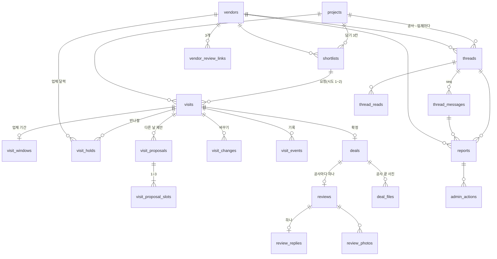

# 믿집 v3 데이터 모델 (개발자)

- 쓴 날: 2026-11-18 · 기준: 지금 head `0023_reference_simplify`(표 44개), `docs/v2/erd.md`, 9판 화면 · 규칙
- 결정 근거: `adr/dev-03`(손님) · `dev-04`(실측 일정 · 기한) · `dev-05`(채팅) · `dev-06`(단가 줄) · `dev-07`(리뷰 · 신고)

## 1. 원칙 (지금 그대로 이어요)

- 돈은 원 단위 `bigint`, 날짜는 서울 기준 `date`, 시각은 `timestamptz`, 면적은 `numeric(7,1)` + 기준(공급 · 전용). 평은 표시 · 단가 줄 수량에만 써요(계산 엔진).
- id는 uuid7. 제약 이름은 `app/db.py` NAMING 규칙.
- 상태는 기능 service 한 곳에서만 바꿔요: 허용 전이 확인 → 조건부 UPDATE(1행이 아니면 409) → 같은 트랜잭션에 이력 행.
- 고유성 · 참조 · 값 범위는 DB 제약(UNIQUE · FK · CHECK · 부분 UNIQUE)으로 지켜요. IntegrityError는 409로 바꿔요.
- JSONB는 통째로 남기는 기록에만 써요(지금 `vendor_reviews.changes`처럼).
- Redis에는 원본을 두지 않아요(줄기 · 요청 제한 · 큐만).
- 이미 적용된 migration은 고치지 않고 새 revision을 더해요. CHECK · 부분 인덱스는 `alembic check`가 비교하지 않으니 제약 테스트를 따로 써요(8장).

## 2. 마이그레이션 순서 (0024~)

한 줄로 이어요(head 하나). 묶음이 나눠 만들어도 번호는 아래로 미리 정해요(`plan-build.md`).

| 번호 | 이름 | 내용 | 맡는 묶음 |
| --- | --- | --- | --- |
| 0024 | `0024_v3_project` | projects(동 · 예산 원 · 출처 · 멱등 키), project_trades(범위 · 면), project_spaces(공간 종류), standard_quotes(범위 사본) | B1a |
| 0025 | `0025_v3_vendor` | vendors(바로 확정 기본값 · 정지 · 거절 사유 하나 더), 단가 묶음 `rows_ver` · 줄 `mode`, 시공 사진 ㎡ · 벽지, 외부 리뷰 링크 새 표, 실측 견적서 '포함됐나요?' 칩 4칸 | B1a |
| 0026 | `0026_v3_visit` | shortlists 새 표(+ 지금 살아 있는 요청으로 채움), visits 상태 · 칸 늘림, visit_events 칸 늘림, visit_windows · visit_holds · visit_proposals(+slots) · visit_changes 새 표 | B1a |
| 0027 | `0027_v3_jobs` | jobs 새 표 | B1a |
| 0028 | `0028_v3_thread` | threads · thread_messages · thread_reads 새 표, files.kind 3개 더 | B1a(표) → B1b(코드) |
| 0029 | `0029_v3_review_report` | reviews · review_photos · review_replies · reports · admin_actions 새 표 | B1a(표) → B1b(코드) |
| 0030 | `0030_v3_work` | date_proposals.days · deals(날 목록 · 끝 글) · deal_events.code · deal_files 새 표, extra_charges 답 값 · 판 · 멱등 키 | B1a |
| 0031 | `0031_v3_cleanup` (나중) | v3에서 안 쓰는 칸 지우기(9장). 코드에서 다 뺀 뒤, 팀 확인 11 결과를 보고 | B1a |
| 0032~0035 | 예약 | B1b · B5 · B6 · B7이 더 필요하면 이 번호만 써요 | |

- 0024~0030은 **0단계(계약 먼저)**에 B1a가 한꺼번에 만들어요. 그래야 B1b · 화면 묶음이 같은 스키마 · OpenAPI 위에서 시작해요.
- 모든 migration은 downgrade를 써요(conftest가 upgrade → downgrade → upgrade로 돌려요).

## 3. 바뀌는 표

### projects (0024)

| 칸 | 형 | 제약 · 뜻 |
| --- | --- | --- |
| `emd` | varchar(20) null | 읍면동(상계동). v3에서 새로 만드는 행은 꼭 받아요(service). 업체에는 구 · 동까지만 가요 |
| `budget_won` | bigint null | 예산(원). CHECK `budget_won between 100000 and 10000000000 and budget_won % 10000 = 0`. 비우면 '아직 몰라요'. 지금 `budget`(구간)은 옛 행용으로 둬요 |
| `source` | varchar(8) not null default `'v2'` | CHECK in (`v2`, `guest`, `member`). 손님 답을 옮겼는지 보는 데 써요 |
| `client_key` | uuid null | 손님 답 옮기기 멱등 키. UNIQUE(`owner_id`, `client_key`) → 같은 키 두 번이면 만든 것을 돌려줘요 |

- `house_type` CHECK = 'apt' 그대로예요(D01 A: 아파트만, 나머지는 화면에서 '준비 중').
- 면적: v3 새 행은 `area_m2` + `area_basis`만 써요(평은 화면 도움 '평으로 넣기'). 지금 CHECK `size`가 둘 중 하나를 지켜요.
- 희망일: `start_kind` in (`date`, `unknown`)만 써요(지금 CHECK 그대로).
- `apt_name` · `dong` · `ho`(동 · 호수)는 v3에서 쓰지 않아요. 고객이 채팅에 직접 써요(9장).

### project_trades (0024)

| 칸 | 형 | 제약 |
| --- | --- | --- |
| `scope` | varchar(8) not null default `'full'` | CHECK in (`full`, `partial`) |
| `faces` | varchar(8)[] not null default `'{wall,ceiling}'` | CHECK `faces <@ array['wall','ceiling'] and cardinality(faces) between 1 and 2`, CHECK `scope <> 'full' or faces @> array['wall','ceiling']`(전체는 벽 + 천장) |

- 벽지: `grade` in (`economy`, `basic`)를 그대로 쓰고 화면 말만 '합지 · 실크'로 바꿔요(팀 확인 15 — 이름을 바꾸면 손댈 곳이 많아 값은 그대로 두자고 제안).
- 부분 공사 공간은 지금 `project_trade_spaces`(공종 × 공간)를 그대로 써요.

### project_spaces (0024)

| 칸 | 형 | 제약 |
| --- | --- | --- |
| `kind` | varchar(12) null | CHECK in (`living` 거실, `kitchen` 주방, `master` 안방, `room1` 작은방 1, `room2` 작은방 2, `hall` 복도, `entry` 현관, `dress` 드레스룸). 부분 UNIQUE(`project_id`, `kind`) where kind is not null. 공간 몫은 계산 엔진 표(`refprice`)에서 kind로 찾아요 |

### standard_quotes (0024)

| 칸 | 형 | 제약 |
| --- | --- | --- |
| `scope` | varchar(8) not null default `'full'` | CHECK in (`full`, `partial`) |
| `faces` | varchar(8)[] not null default `'{wall,ceiling}'` | 만든 때 사본 |
| `space_keys` | varchar(12)[] not null default `'{}'` | 부분이면 고른 공간 kind 사본 |
| `share_ver` | varchar(20) null | 공간 몫 표 판(부분일 때만). CHECK `(scope = 'partial') = (share_ver is not null)` |

- 줄 단위에 `'평'`을 써요(`unit` varchar(10) 그대로). 산식 판 `formula_ver`를 올려요(6장).

### vendors (0025)

| 칸 | 형 | 제약 · 뜻 |
| --- | --- | --- |
| `instant_default` | boolean not null default false | 기간 답하기 '바로 확정' 토글의 처음 값 · 목록 '바로 확정' 배지(I5) |
| `suspended_at` | timestamptz null | 업체 기능 멈춤(D26). 승인 상태와 따로 |
| `suspend_scope` | varchar(4) null | CHECK in (`new` 새 요청만, `all` 진행 중도 닫음), CHECK `(suspended_at is null) = (suspend_scope is null)` |

- 거절 사유 코드에 `info_mismatch`(사업자등록증과 신청 정보가 달라요, A04)를 더해요. `vendors`와 `vendor_reviews`의 `_CODE_KIND` CHECK를 함께 바꿔요.
- 목록에 보이는 업체 = 승인됨 + `suspended_at is null` + 공종 · 지역 맞음. `dobae_v3` 확인 묶음이 없으면 목록에는 보이되 '가견적 준비 중'으로 담기를 막아요(D06 A).

### vendor_price_sets · vendor_price_lines (0025)

| 표 · 칸 | 형 | 제약 |
| --- | --- | --- |
| `vendor_price_sets.rows_ver` | varchar(12) not null default `'dobae_v2'` | CHECK in (`dobae_v2`, `dobae_v3`, `mokgong_v1`). 목공 묶음은 `mokgong_v1`로 채워요 |
| `vendor_price_lines.mode` | varchar(10) not null default `'price'` | CHECK in (`price`, `included`, `excluded`). 지금 CHECK `price_or_included`를 지우고 CHECK `(mode = 'price') = (unit_price is not null)` · `(mode = 'included') = (included_in is not null)`로 바꿔요. `included_in`이 있던 행은 `included`로 채워요 |

- (업체, 공정) 확인 묶음 하나 규칙은 그대로예요. v3 묶음을 확인하면 옛 v2 묶음은 `retired`가 되고, 그 묶음을 가리키는 옛 요청의 가견적 사본은 그대로예요.

### vendor_portfolio (0025)

- `area_m2 numeric(7,1) null`(CHECK > 0, V16 '면적은 ㎡로'), `paper varchar(10) null`(CHECK in economy, basic). 지금 `pyeong`은 옛 행용.

### vendor_quotes (0025, D21 '포함됐나요?')

| 칸 | 형 | 제약 |
| --- | --- | --- |
| `incl_removal` | boolean null | 기존 벽지 철거 |
| `incl_waste` | boolean null | 폐기물 처리 |
| `paper_spec` | varchar(60) null | 벽지 제조사 · 규격(LX 베스띠 · 폭 106cm). CHECK `length(btrim(paper_spec)) > 0` |
| `warranty_months` | smallint null | 하자 보수 기간(개월). CHECK `between 0 and 120` |

### visits (0026, dev-04)

| 칸 | 형 | 제약 · 뜻 |
| --- | --- | --- |
| `status` | varchar(10) | CHECK in (`requested` 답 기다림, `offered` 날짜 고를 차례, `picked` 수락 기다림, `proposed` 다른 날 제안 옴, `booked` 실측 확정, `visited` 실측 받음, `quoted` 견적서 옴, `chosen` 업체 확정, `declined` 못 받음, `expired` 기한 지남, `cancelled` 취소, `no_show` 업체가 안 옴, `closed` 닫힘) |
| 살아 있는 상태 | — | requested · offered · picked · proposed · booked · visited · quoted · chosen. 지금 부분 UNIQUE `uq_visits_slot` · `uq_visits_vendor`를 이 목록으로 다시 만들어요 |
| `shortlist_id` | uuid null | FK shortlists ON DELETE SET NULL |
| `attempt` | smallint not null default 1 | CHECK ≥ 1(v3는 service가 2까지). UNIQUE(`project_id`, `trade`, `vendor_id`, `attempt`). 옛 행은 만든 순서로 채워요 |
| `wish_start` · `wish_end` | date null | 고객 희망 기간(보낼 때 고정). CHECK 둘 다 비거나 `wish_end >= wish_start and wish_end - wish_start <= 62` |
| `reply_due_at` | timestamptz null | 보낸 때 + 48시간(계산 엔진). 옛 행은 비움(기한 없음) |
| `booked_day` · `booked_half` | date · varchar(2) null | 확정한 반나절 사본(목록 · 채팅 띠용). CHECK `booked_half in ('am','pm')`, `(booked_day is null) = (booked_half is null)` |
| `quote_due_at` | timestamptz null | 실측일 + 3일 18:00(D19) |
| `expired_reason` | varchar(8) null | CHECK in (`reply`, `pick`), CHECK `(status = 'expired') = (expired_reason is not null)` |
| `cancel_code` | varchar(12) null | CHECK in (`changed` 일정이 바뀌었어요, `other_vendor` 다른 업체로 할래요, `late_quote` 견적서 늦어서 닫음, `other` 그 밖), CHECK `cancel_code is null or status = 'cancelled'` |
| `cancel_note` | varchar(100) null | '그 밖'일 때 한 줄 |
| `visited_at` | timestamptz null | 고객 '실측 받았어요' |
| `requote_at` | timestamptz null | 유효기간 지난 뒤 '다시 받기' 요청(D20) |

- 가견적 사본(`estimate_set_id` · `estimate_total`)은 보낼 때 고정해요(지금 그대로).
- 요청 사진은 `project_files`(role photo · 공간)를 그대로 써요.

### visit_events (0026)

- `from_status` · `to_status` CHECK를 새 상태 목록으로 바꿔요. 상태가 그대로인 기록(바꾸기 요청 · 바꾸기 수락)은 from = to로 남겨요.
- `code` 값(varchar(20)): `asked` · `re_asked` · `answered` · `declined` · `picked` · `booked` · `hold_released` · `proposed` · `proposal_picked` · `repick` · `change_requested` · `change_accepted` · `change_countered` · `change_expired` · `cancelled` · `visited` · `no_show` · `quote_sent` · `expired` · `closed` · `requote`.
- 새 칸: `day date null` · `half varchar(2) null`(CHECK am · pm) · `day_to date null`. 기록 탭(C63 · I2)의 '12.13~12.18' · '12.15(화) 오전'을 이 칸으로 그려요(글은 화면이 만들어요).

### date_proposals · deals · deal_events · extra_charges (0030)

| 표 · 칸 | 형 | 제약 · 뜻 |
| --- | --- | --- |
| `date_proposals.days` | date[] null | 업체가 하나씩 고른 공사 날(V11). CHECK `days is null or cardinality(days) between 1 and 120`. `start_date` · `end_date`는 처음 · 마지막 날(service). 날 수 = 견적서 공사 기간 · 공휴일 · 겹침은 계산 엔진이 봐요 |
| `deals.work_days` | date[] null | 수락한 공사 날 |
| `deals.done_note` | varchar(300) null | '남길 말'(V13) |
| `deals.done_posted_at` | timestamptz null | '공사 끝냈어요'를 올린 때(자동 끝 7일 기준) |
| `deal_events.code` | varchar(20) null | `auto_done` · `dates_sent` · `dates_accepted` · `extra_sent` · `extra_answered` 등 기록용 |
| `deal_files` | 새 표 | (`deal_id`, `file_id`) PK, file UNIQUE, `sort` 0~9. files.kind = `done_photo` |
| `extra_charges.ack` | varchar(10) | CHECK in (`pending`, `approved`, `rejected`, `asked`). 지금 `ok` → approved, `talk` → asked로 바꿔 채워요(D23) |
| `extra_charges.group_id` · `version` · `superseded_at` | uuid · smallint · timestamptz | 업체가 고치면 새 판(D23). UNIQUE(`group_id`, `version`), 부분 UNIQUE(`group_id`) where superseded_at is null. 옛 행은 group_id = id, version 1 |
| `extra_charges.client_key` | uuid null | UNIQUE(`deal_id`, `client_key`)(9판 dup '추가 금액') |

- 합계에는 '승인 · 최신 판'만 들어가요(승인 전 합계 밖, D23). 계산 엔진이 더해요.

### files (0028)

- kind CHECK에 `chat_photo` · `review_photo` · `done_photo`를 더해요.

## 4. 새 표

### shortlists — 담기 (0026)

| 칸 | 형 | 제약 |
| --- | --- | --- |
| `id` | uuid PK | |
| `project_id` | uuid | FK projects ON DELETE CASCADE |
| `trade` | varchar(10) | CHECK in (dobae, mokgong) |
| `vendor_id` | uuid | FK vendors ON DELETE CASCADE |
| `slot` | smallint | CHECK `between 1 and 3` |
| `status` | varchar(8) default `'active'` | CHECK in (`active`, `removed`) |
| `removed_code` | varchar(12) null | CHECK in (`customer`, `expired`, `declined`, `cancelled`, `no_show`, `closed`), CHECK `(status = 'active') = (removed_code is null)` |
| `created_at` · `removed_at` | timestamptz | CHECK `(status = 'removed') = (removed_at is not null)` |

- 부분 UNIQUE(`project_id`, `trade`, `vendor_id`) where active → 두 번째 담기 409(9판 dup '업체 담기').
- 부분 UNIQUE(`project_id`, `trade`, `slot`) where active → 4번째 담기 409. 칸을 고를 때 프로젝트 행을 잠가요(지금 `lock_for_visit`과 같은 줄 서기).
- 0026이 지금 살아 있는 요청(requested · quoted · chosen)마다 active 행을 만들어요(slot = 요청 slot).

### visit_windows — 업체가 되는 기간 (0026)

| 칸 | 형 | 제약 |
| --- | --- | --- |
| `visit_id` | uuid PK | FK visits CASCADE (요청마다 답 하나) |
| `start_date` · `end_date` | date | CHECK `end_date >= start_date and end_date - start_date <= 62` |
| `excluded` | date[] default `'{}'` | 빼는 날. CHECK `cardinality(excluded) <= 31`. 기간 안인지는 service |
| `instant` | boolean | 바로 확정(이 답에서 켠 값이 기준) |
| `answered_at` · `pick_due_at` | timestamptz | 고르기 기한 = 답 + 7일(D09) |

### visit_holds — 반나절 잡기 · 확정 (0026)

| 칸 | 형 | 제약 |
| --- | --- | --- |
| `id` | uuid PK | |
| `vendor_id` | uuid | FK vendors CASCADE |
| `visit_id` | uuid | FK visits CASCADE |
| `day` | date | |
| `half` | varchar(2) | CHECK in (`am`, `pm`) |
| `kind` | varchar(6) | CHECK in (`hold` 잡아 둠, `booked` 확정) |
| `status` | varchar(8) default `'active'` | CHECK in (`active`, `released`) |
| `until` | timestamptz null | 잡아 둔 기한(= 수락 기한). CHECK `(kind = 'hold') = (until is not null)` |
| `created_at` · `released_at` | timestamptz | CHECK `(status = 'released') = (released_at is not null)` |

- **부분 UNIQUE(`vendor_id`, `day`, `half`) where status = 'active'** → 같은 업체 같은 반나절은 한 고객만(C16 '방금 다른 고객이 골랐어요', 409 `slot_taken`).
- 부분 UNIQUE(`visit_id`) where status = 'active' → 요청 하나에 살아 있는 잡기 하나.
- 바로 확정으로 잡힌 반나절 · 잡아 둔 반나절은 다른 요청의 열린 반나절에서 빠져요(계산 엔진 `slots.open_halves(window, excluded, taken)`).

### visit_proposals · visit_proposal_slots — 다른 날 제안 (0026)

| 표 · 칸 | 형 | 제약 |
| --- | --- | --- |
| `visit_proposals.id` | uuid PK | |
| `visit_id` | uuid | FK visits CASCADE |
| `change_id` | uuid null | FK visit_changes SET NULL(바꾸기 요청에 업체가 다른 날을 낸 것, V20) |
| `reason_code` | varchar(12) | CHECK in (`other_site` 다른 현장이 있어요, `no_crew` 자재 · 사람이 안 돼요, `other` 그 밖) |
| `note` | varchar(100) null | |
| `status` | varchar(10) default `'open'` | CHECK in (`open`, `picked`, `repicked`, `expired`), 부분 UNIQUE(`visit_id`) where open |
| `due_at` · `created_at` · `closed_at` | timestamptz | 제안 + 48시간. CHECK `(status = 'open') = (closed_at is null)` |
| `visit_proposal_slots` | (`proposal_id`, `day`, `half`) PK | FK CASCADE. 1~3개 · 고객 희망 기간 안(service, V07) |

### visit_changes — 일정 바꾸기 요청 (0026)

| 칸 | 형 | 제약 |
| --- | --- | --- |
| `id` | uuid PK | |
| `visit_id` | uuid | FK visits CASCADE, 부분 UNIQUE(`visit_id`) where status = 'open'(열린 요청 하나) |
| `from_day` · `from_half` · `to_day` · `to_half` | date · varchar(2) | CHECK half in (am, pm), CHECK `(from_day, from_half) <> (to_day, to_half)` |
| `status` | varchar(10) default `'open'` | CHECK in (`open`, `accepted`, `countered`, `withdrawn`, `expired`) |
| `due_at` | timestamptz | 요청 + 48시간(답이 없으면 원래 일정 그대로) |
| `by_id` | uuid null | FK users SET NULL |
| `created_at` · `closed_at` | timestamptz | CHECK `(status = 'open') = (closed_at is null)` |

- 받기 전까지 원래 반나절 그대로예요(C28). 받으면 옛 booked 잡기 released + 새 booked 잡기(겹치면 409) + `visits.booked_*` 바꿈 + 기한 일 다시.

### jobs — 기한 일 (0027)

| 칸 | 형 | 제약 |
| --- | --- | --- |
| `id` | uuid PK | |
| `kind` | varchar(30) | CHECK in (architecture.md 6장 표의 13개) |
| `ref_id` | uuid null | 대상 행 id(FK 없음: 대상이 지워지면 처리 함수가 skipped로 끝내요) |
| `run_at` | timestamptz | |
| `status` | varchar(10) default `'pending'` | CHECK in (`pending`, `running`, `done`, `skipped`, `failed`, `cancelled`) |
| `attempts` | smallint default 0 | CHECK `between 0 and 10` |
| `locked_until` | timestamptz null | CHECK `(status = 'running') = (locked_until is not null)` |
| `last_error` | varchar(60) null | 오류 종류 이름만(입력값 · 개인정보 없음) |
| `dedup_key` | varchar(80) UNIQUE | `kind:ref_id:run_at` 꼴. 같은 일을 두 번 넣지 않아요 |
| `created_at` · `done_at` | timestamptz | CHECK `(status in ('done','skipped','failed','cancelled')) = (done_at is not null)` |

- 부분 인덱스 `ix_jobs_due(run_at) where status = 'pending'`. 수거: `select … where status = 'pending' and run_at <= now() order by run_at limit 50 for update skip locked` → running(locked_until = now + 2분) → commit → 처리 → done · skipped · (실패면 pending + attempts + 1 + run_at 뒤로).
- 멈춘 일: `running`이고 `locked_until < now()`면 다음 수거가 다시 가져가요.

### threads · thread_messages · thread_reads — 고객-업체 채팅 (0028, dev-05)

| 표 · 칸 | 형 | 제약 · 뜻 |
| --- | --- | --- |
| `threads.id` | uuid PK | |
| `project_id` | uuid null | FK projects **SET NULL**(탈퇴해도 업체 쪽 글은 남김, C53) |
| `vendor_id` | uuid null | FK vendors SET NULL |
| `customer_id` | uuid null | FK users SET NULL |
| `visit_id` | uuid null | FK visits SET NULL. 가장 최근 확정한 요청 |
| UNIQUE | (`project_id`, `vendor_id`) | (공사, 업체)마다 대화 하나 |
| `status` | varchar(10) default `'open'` | CHECK in (`open`, `read_only`) |
| `ro_reason` | varchar(12) null | CHECK in (`other_chosen`, `cancelled`, `declined`, `withdrawn`, `blocked`, `admin`), CHECK `(status = 'open') = (ro_reason is null)` |
| `last_seq` | int default 0 | CHECK ≥ 0. 글마다 대화 행 잠금 아래 +1 |
| `last_message_at` | timestamptz null | 목록 정렬 |
| `customer_label` · `vendor_label` · `area_label` | varchar(40) · varchar(100) · varchar(60) | 만든 때 사본: '상계동 고객' · '마루와벽' · '노원구 상계동 69.4㎡'. 업체 화면에는 고객 이름이 없어요 |
| `vendor_muted_at` | timestamptz null | 관리자 '채팅 쓰기 막기'(A02) |
| `blocked_at` | timestamptz null | 고객이 차단(C31) |
| `address_sent_at` | timestamptz null | 고객 글이 동 · 호 꼴 규칙에 걸린 때(I7 B) |
| `created_at` · `closed_at` | timestamptz | |
| `thread_messages.id` | uuid PK | |
| `thread_id` | uuid | FK threads CASCADE |
| `seq` | int | CHECK ≥ 1, UNIQUE(`thread_id`, `seq`) |
| `sender_role` | varchar(8) | CHECK in (`customer`, `vendor`, `system`) |
| `sender_id` | uuid null | FK users SET NULL |
| `kind` | varchar(8) | CHECK in (`text`, `photo`, `system`), CHECK `(kind = 'system') = (sender_role = 'system')`, CHECK `kind <> 'system' or system_code is not null` |
| `body` | varchar(1000) null | 글(비우는 것은 보관 기간 정리 때만) |
| `file_id` | uuid null | FK files SET NULL(파일이 지워지면 '사진을 볼 수 없어요') |
| `system_code` · `ref_id` | varchar(30) · uuid null | 시스템 카드: `visit_booked` · `change_requested` · `change_done` · `quote_sent` · `extra_sent` 등 + 대상 id |
| `warn` | varchar(8) null | CHECK in (`offsite`). 믿집 밖 거래 주의 줄(고객 화면만, D05 A) |
| `client_key` | uuid null | UNIQUE(`thread_id`, `sender_id`, `client_key`) → 같은 글 두 번 저장 안 함 |
| `created_at` · `redacted_at` | timestamptz | |
| `thread_reads` | (`thread_id`, `user_id`) PK | FK CASCADE 둘 다, `last_read_seq` int ≥ 0(줄지 않게 `greatest`로 올려요) |

- 안 읽은 수 = `threads.last_seq - thread_reads.last_read_seq`(내 글은 보낼 때 내 읽음도 올려요).
- 색인: (`customer_id`, `last_message_at desc`), (`vendor_id`, `last_message_at desc`).

### reviews · review_photos · review_replies (0029, dev-07)

| 표 · 칸 | 형 | 제약 |
| --- | --- | --- |
| `reviews.id` | uuid PK | |
| `deal_id` | uuid null | FK deals SET NULL, **UNIQUE**(공사마다 한 번) |
| `vendor_id` | uuid | FK vendors CASCADE |
| `project_id` · `author_id` | uuid null | FK SET NULL(탈퇴 처리는 사용자 확인 필요, dev-07) |
| `rating` | smallint | CHECK `between 1 and 5` |
| `tags` | varchar(12)[] default `'{}'` | CHECK `tags <@ array['seam','on_time','kind','tidy']`(이음매 · 약속한 날 · 설명 친절 · 뒷정리) |
| `body` | varchar(1000) null | |
| `context_label` | varchar(60) | '노원구 아파트 · 실크' 사본 |
| `status` | varchar(8) default `'shown'` | CHECK in (`shown`, `hidden`) |
| `hidden_code` | varchar(12) null | CHECK in (`abuse`, `privacy`, `unrelated`, `paid`)(C49 내리는 기준), CHECK `(status = 'hidden') = (hidden_code is not null)` |
| `created_at` · `edited_at` | timestamptz | `edited_at`이 있으면 '수정됨' |
| `review_photos` | (`review_id`, `file_id`) PK | file UNIQUE, `sort` 0~4, files.kind = `review_photo` |
| `review_replies.review_id` | uuid PK | FK reviews CASCADE(리뷰마다 답글 하나, I4) |
| `vendor_id` · `body` · `created_at` · `edited_at` | | body CHECK `length(btrim(body)) > 0`, varchar(1000) |

- 별점 · 리뷰 수 · 믿집 공사 수는 읽을 때 계산해요(업체 수가 적어 충분해요). 반올림(소수 한 자리)은 계산 엔진.

### reports · admin_actions (0029, dev-07)

| 표 · 칸 | 형 | 제약 |
| --- | --- | --- |
| `reports.id` | uuid PK | |
| `kind` | varchar(8) | CHECK in (`chat`, `vendor`, `link`) |
| `reporter_id` | uuid null | FK users SET NULL |
| `vendor_id` · `thread_id` · `message_id` | uuid null | FK SET NULL. 종류별 대상은 service가 확인 |
| `link_sort` | smallint null | 외부 리뷰 링크 번호 0~2 |
| `reason_code` | varchar(12) | CHECK `(kind in ('chat','vendor') and reason_code in ('offsite','abuse','promise','other')) or (kind = 'link' and reason_code in ('wrong_place','not_vendor','other'))` |
| `note` | varchar(300) null | |
| `evidence` | varchar(1000) null | 신고 때 글 사본(신고된 메시지는 데이터로만 보여 줘요) |
| `block` | boolean default false | 신고하면서 차단도 했는지 |
| `status` | varchar(10) default `'open'` | CHECK in (`open`, `resolved`, `dismissed`) |
| `action` | varchar(12) null | CHECK in (`warn`, `mute_chat`, `suspend_new`, `suspend_all`, `hide_link`, `none`), CHECK `(status = 'open') = (action is null)` |
| `admin_note` · `resolved_by` · `resolved_at` · `created_at` | | CHECK `(status = 'open') = (resolved_at is null)` |
| 부분 UNIQUE | (`reporter_id`, `message_id`) where status = 'open' and message_id is not null | 같은 글 두 번 신고 막기 |
| `admin_actions` | id · `admin_id`(SET NULL) · `action` varchar(20) · `target_user_id` · `report_id` · `review_id`(SET NULL) · `note` varchar(300) · `at` | action CHECK in (`suspend_user`, `unsuspend_user`, `warn_vendor`, `mute_vendor`, `unmute_vendor`, `suspend_vendor`, `unsuspend_vendor`, `hide_review`, `show_review`, `link_shown`, `link_hidden`, `dismiss_report`) |

### vendor_review_links — 외부 리뷰 링크 (0025)

| 칸 | 형 | 제약 |
| --- | --- | --- |
| (`vendor_id`, `sort`) | PK | FK vendors CASCADE, `sort` CHECK 0~2(3개까지) |
| `label` · `url` | varchar(40) null · varchar(300) | CHECK `url ~ '^https://'` |
| `status` | varchar(10) default `'checking'` | CHECK in (`checking` 확인 중, `shown` 보여요, `hidden`), CHECK `(status = 'checking') = (checked_at is null)` |
| `note` · `checked_by` · `checked_at` · `created_at` | | |

- 시공 사례 링크(5개, `vendor_links`)는 그대로예요.

## 5. 상태와 허용 전이

### visits (v3)

| 지금 | 다음 | 누가 · 무엇 | 함께 하는 일 |
| --- | --- | --- | --- |
| (없음) | requested | 고객 '고른 곳에 요청 보내기' | 담긴 업체 · 가견적 있음 · 고른 벽지 됨 · 시도 ≤ 2 · 프로젝트 잠금 · 가견적 사본 · jobs `visit_reply_due` · 업체 알림 |
| requested | offered | 업체 '기간 보내기'(V04) | 기한 전 · window · jobs pick_due · reply_due 취소 · 고객 알림 |
| requested | declined | 업체 '못 받아요'(V05, 사유 3개) | 칸 비움(removed declined) · 고객 알림 |
| requested | expired(reply) | worker | 칸 비움 · 고객 알림 '답하지 않았어요' · 한 번 더 요청 가능(시도 2) |
| requested · offered · picked · proposed | cancelled | 고객 '요청 취소' | 잡기 풀기 · 칸 비움 · 업체 알림 |
| offered | picked | 고객 날짜 보내기(바로 확정 끔, C19) | hold(until = +48시간) · jobs accept_due · 업체 알림 |
| offered | booked | 고객 확인 창 '확정'(바로 확정 켬, C61) | booked 잡기 · thread.open + 시스템 카드 · jobs reminder · quote_due · 양쪽 알림 |
| offered | expired(pick) | worker(+7일) | 칸 비움 · 업체 알림 |
| picked | booked | 업체 '수락'(V06) | hold → booked · thread.open · 기한 일 |
| picked | proposed | 업체 '다른 날 제안'(V07) | hold 풀기 · 제안 1~3개 · jobs proposal_due · 고객 알림 |
| picked | offered | worker(accept_due) | hold 풀기(**D12 보류 최소 처리, 팀 확인**) |
| proposed | booked | 고객 제안 날 고르기(C21) | booked 잡기(겹치면 409) · 제안 picked |
| proposed | offered | 고객 '다시 고르기' · worker(proposal_due) | 제안 repicked · expired |
| booked | booked | 업체 바꾸기 '받기'(V20) | 옛 잡기 released · 새 booked · 기한 일 다시 · 시스템 카드 |
| booked | visited | 고객 '실측 받았어요'(C32) | 실측 시각 지난 뒤(오전 13:00 · 오후 18:00, 계산 엔진) |
| booked | no_show | 고객 '업체가 안 왔어요' | 칸 비움 · 기록 |
| booked · visited | quoted | 업체 견적서 보내기(V10) | 지금 흐름(quote_ver) |
| booked · visited | cancelled | 고객 '실측 취소'(C30) · '견적서 늦어요 → 닫기' | 잡기 풀기 · 칸 비움 · 대화 읽기만(cancelled) |
| quoted | chosen | 고객 확정(C34) | deal · 다른 요청 closed · 다른 대화 읽기만(other_chosen) |
| requested ~ quoted | closed | 다른 업체 확정 · 다시 고르기 | 지금 흐름 |
| chosen | closed | 다시 고르기(날짜 수락 전) | 지금 흐름 |

- 지난 상태(declined · expired · cancelled · no_show · closed)에서는 나가지 않아요. 다시 요청은 새 행(시도 2)이에요.
- '기한 지남'(답 · 고르기)은 상태로도 두고, 그 전에는 화면이 `*_due_at`과 지금 시각으로 '곧 지남'을 계산해요.

### 그 밖

| 대상 | 전이 |
| --- | --- |
| shortlists | active → removed(고객 빼기 · 요청 끝남 · 확정 뒤) |
| visit_holds | active(hold) → active(booked) · released / active(booked) → released(취소 · 바꾸기) |
| visit_proposals | open → picked · repicked · expired |
| visit_changes | open → accepted · countered(업체 다른 날 제안) · withdrawn(고객 취소) · expired |
| threads | open → read_only(사유) / read_only(blocked · admin) → open(풀기) |
| reviews | shown ⇄ hidden(관리자, 사유 코드 · admin_actions) |
| reports | open → resolved · dismissed |
| jobs | pending → running → done · skipped · failed / running → pending(다시, attempts + 1) / pending → cancelled |
| extra_charges | pending → approved · rejected · asked / asked → approved · rejected / (판) 최신 → superseded |
| deals | 지금 그대로 + checking → done(worker, 7일 자동, code `auto_done`) |
| vendors(운영) | suspended_at 없음 ⇄ 있음(관리자) |
| users | active ⇄ suspended(관리자, A03) |

### 같은 요청 두 번 · 동시 요청 (D29 A)

| 경우 | 막는 것 | 응답 |
| --- | --- | --- |
| 같은 업체 두 번 담기 | shortlists 부분 UNIQUE(공사, 공종, 업체) | 409 `already` |
| 4번째 담기 · 같은 칸 동시 | shortlists 부분 UNIQUE(공사, 공종, 칸) + 프로젝트 행 잠금 | 409 `slots_full` · `stale` |
| 같은 반나절 두 고객 | visit_holds 부분 UNIQUE(업체, 날, 반나절) | 409 `slot_taken` |
| 업체 답 vs 고객 취소 동시 | 조건부 UPDATE(status = 'requested') | 늦은 쪽 409 `stale` |
| 단가 확인 두 번 | (업체, 공정, 판) UNIQUE · 본 판 + 1 | 409 `stale` |
| 채팅 글 두 번 | (대화, 보낸 사람, client_key) UNIQUE | 200 같은 글 |
| 추가 금액 두 번 | (확정, client_key) UNIQUE | 200 같은 줄 |
| 리뷰 두 번 | reviews.deal_id UNIQUE | 409 `already` |
| 손님 답 두 번 옮기기 | projects(owner, client_key) UNIQUE | 200 같은 공사 |
| worker 둘이 같은 일 | `FOR UPDATE SKIP LOCKED` + 처리 함수의 상태 조건 | 한 번만 |

## 6. 단가표 1201~1208 · 표준견적서 v3 맞추기 (dev-06)

### 표준견적서 v3 (계산 엔진, `formula_ver` 올림)

- 지금 엔진(`DOBAE_2026H2`)에서 **도배지 줄만** '실크벽지 시장 평균 가격 · 평 × 평당 값'으로 바꿔요(D07 A). 수량 = 도배 면적 × 1.2(지금 `paper_ratio`) ÷ 3.3058, 소수 한 자리.
- 확인: 공급 69.4㎡ · 실크 · 빈 집이면 벽 130.1㎡ × 5,993 = 779,689 · 천장 43.4㎡ × 8,531 = 370,245 · 실크 63.0평 × 9,500 = 598,500 · 초배지 190.8㎡ × 242 = 46,174 → 공급가 1,794,608 · 부가세 179,461 · 합계 **1,974,069원**으로 9판 C07과 원 단위까지 같아요(`verification/dev.md`). 철거 173.5㎡ × 1,727 = (299,635)는 '실측 후 · 합계 밖' 그대로예요.
- (리드 2026-11-19) 사용자 결정 D07 '시장 평균 가격'에 따라 실크 단가가 B6 `refprice.wallpaper_market.paper_market('silk').per_py` = 벽지 평당 10,749원이 돼요. 그래서 C07 합계는 **2,060,625원**이에요. B1a가 지금 계산 엔진으로 다시 셈해 맞는지 확인했어요(`verification/b1a.md`). 9판 그림의 1,974,069원은 업체 견적 한 장(9,500원) 기준 예시값이에요.
- 합지 평당 시장 평균은 B6가 모았어요. `paper_market('hapji').per_py` = 4,577원이고, 출처는 한 곳이라 사용자 확인이 필요해요(`data-sources.md` · ADR data-01).
- 부분 공사(D02): 벽 · 천장 면적에 고른 공간 몫 합을 곱해요(공간 몫 표 판 = `share_ver`). 9판 C60의 638,501원은 그림 예시값이에요. 같은 몫(46%)이라도 지금 엔진 초배지 비율(벽 1.2)로는 초배지 71.8㎡ · 합계 640,098원이 나와요(그림은 1.1로 그렸어요). 화면에 예시 숫자를 박지 않아요.

### 가견적 v3 (계산 엔진 `PRICE_ROWS['dobae_v3']`, 업체 단가 × 계산 엔진 수량)

| 화면 코드 | 키 | 줄 | 단위 | 수량 | 69.4㎡ 집 예 |
| --- | --- | --- | --- | --- | --- |
| 1201 | `putty` | 퍼티작업 | 평 | 바닥 평 = 면적 ÷ 3.3058 | 21.0평 |
| 1203 | `paper_hapji` | 합지 | 평 | 도배지 평(합지를 고른 집만) | 63.0평 |
| 1204 | `paper_silk` | 실크 | 평 | 도배지 평(실크를 고른 집만) | 63.0평 |
| 1205 | `material` | 부자재 | 평 | 바닥 평 | 21.0평 |
| 1206 | `labor` | 인건비 | 품 | 품(0.5 단위 올림) | 5.0품 |
| 1207 | `meal` | 식대 | 품 | 품 | 5품 |
| 1208 | `truck` | 운송비 | 대 | 1 | 1대 |

- 받는 법(`vendor_price_lines.mode`): `price` 단가 × 수량 · `included` 0원(포함 대상은 같은 묶음의 `price` 줄이어야 해요) · `excluded` 가견적에 안 넣음. 고객이 고른 벽지 줄이 `excluded`면 그 업체는 '이 벽지는 안 해요' · 담기 409 `paper_unsupported`(D07 A).
- 확인: 9판 C11 마루와벽(퍼티 20,000 · 실크 9,500 · 부자재 13,000 · 인건비 300,000 · 식대 · 운송비 105,000) → 공급가 2,896,500 · 부가세 289,650 · 합계 **3,186,150원**, 화면과 같아요.
- 면세 업체(`tax_kind = 'exempt'`)는 부가세 0(지금 `estimate(exempt=True)` 그대로).
- 업체 단가표 화면의 '공급 69.4㎡ 집이면' 열은 같은 함수에 예시 집 수량을 넣어 만들어요.

## 7. 이어지는 법 (새 표 중심)

- `jobs.ref_id`는 FK 없이 여러 표를 가리켜요(대상이 없으면 처리 함수가 skipped).

## 8. 제약 테스트 (B1a · B1b, `alembic check`가 못 보는 것)

- shortlists: 같은 업체 두 번 · 4번째 칸 · 빼고 다시 담기(된다).
- visit_holds: 같은 업체 · 날 · 반나절 active 둘 → IntegrityError, released 뒤 다시 → 된다, 요청 하나에 active 둘 → IntegrityError.
- visits: 새 상태 CHECK, expired ↔ expired_reason, cancel_code는 cancelled일 때만, 시도 UNIQUE, 살아 있는 상태 부분 UNIQUE.
- visit_windows · visit_changes · visit_proposals CHECK(기간 · 열린 것 하나 · 같은 반나절로 바꾸기 금지).
- vendor_price_lines mode CHECK 3가지 · 옛 행 채우기(included_in → included).
- threads ro_reason ↔ status, thread_messages seq UNIQUE · client_key UNIQUE · system ↔ sender_role.
- reviews deal UNIQUE · rating 범위 · tags 키 · hidden ↔ hidden_code, review_replies 하나.
- reports kind × reason_code, open ↔ action · resolved_at.
- jobs running ↔ locked_until, done 계열 ↔ done_at, dedup_key UNIQUE.
- extra_charges ack 값 바꿈(ok → approved, talk → asked) · 판 UNIQUE · 최신 하나.
- 0026 채우기: 살아 있는 옛 요청마다 shortlist 하나 · attempt 번호.

## 9. v3에서 안 쓰게 되는 것 (0031에서 지울 후보)

| 칸 · 표 | 이유 | 지우는 때 |
| --- | --- | --- |
| `visits.share_contact` · `consent_ver` · `consent_at` · `contact_until` · `message` | 연락처 동의 · 공개 대신 채팅(11-18 결정) | B1a가 코드에서 다 뺀 뒤 |
| `projects.apt_name` · `dong` · `ho` | 동 · 호는 고객이 채팅에 직접 | 같음 |
| `vendor_faqs` | 업체 '자주 묻는 5가지'는 7판에서 뺐어요(V16) | 같음 |
| `vendors.contact_method` · `contact_url` · `call_start` · `call_end` | 팀 확인 11(v3에도 둘지) 결과를 보고 | 팀 결정 뒤 |
| `projects.budget`(구간) · `size_band` · `vendor_portfolio.pyeong` | v3 새 행은 안 써요. 옛 행 표시에만 | 옛 데이터가 없어진 뒤 |
